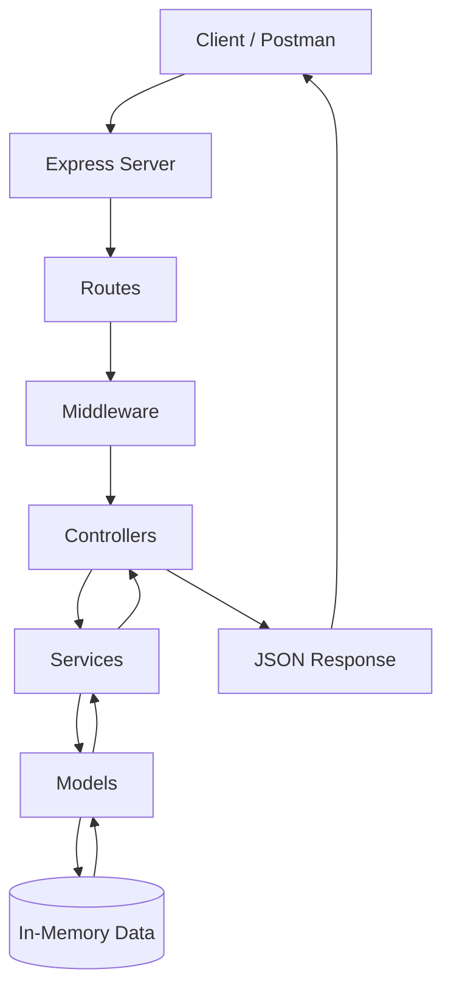
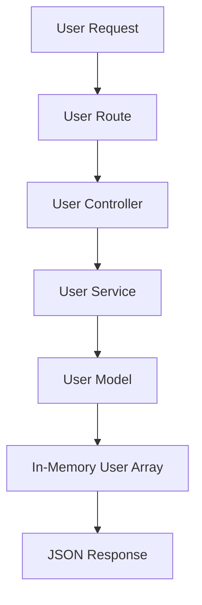
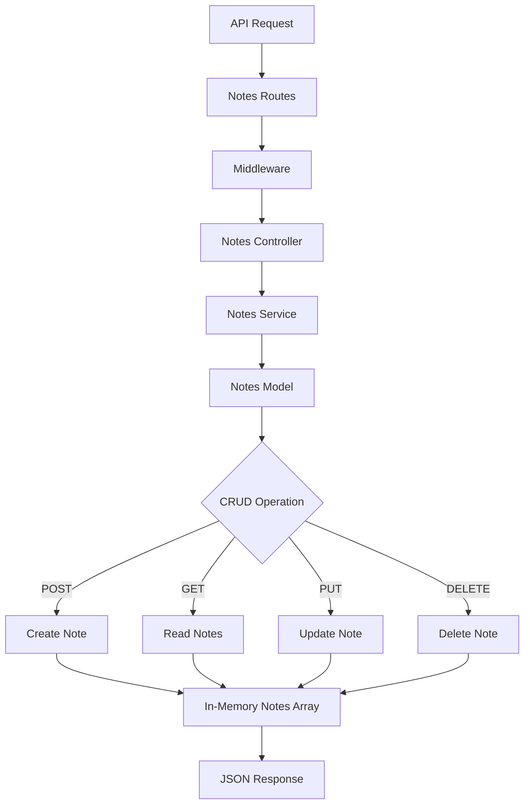
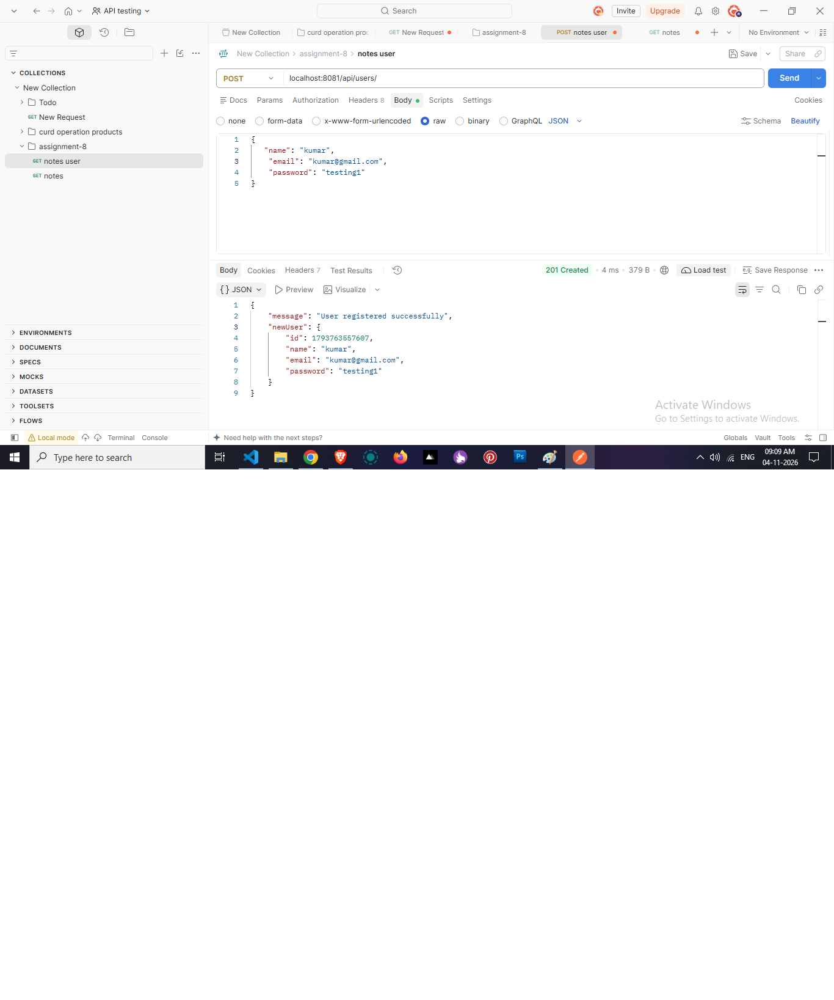
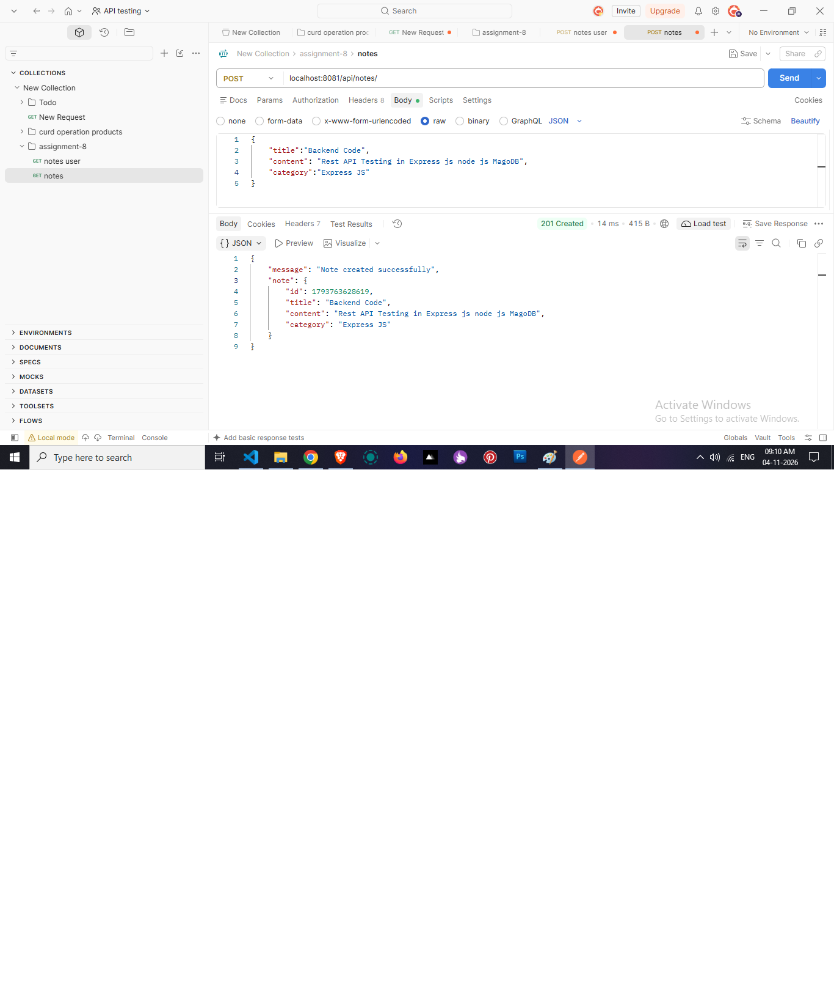
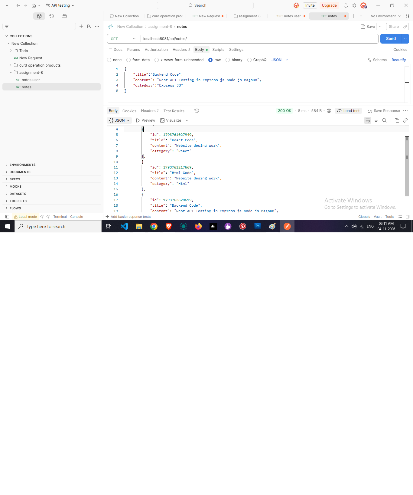
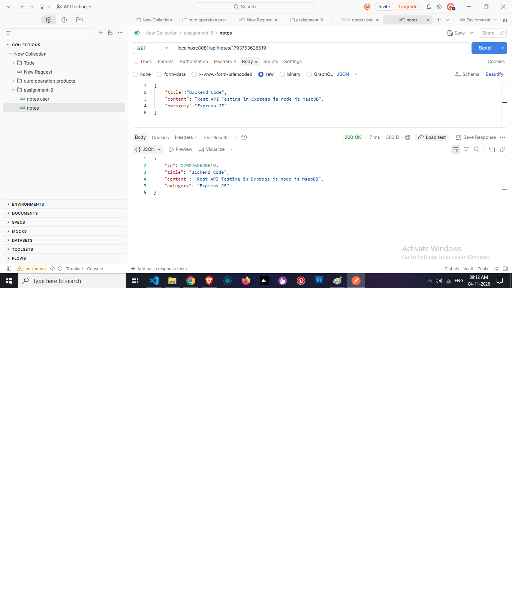
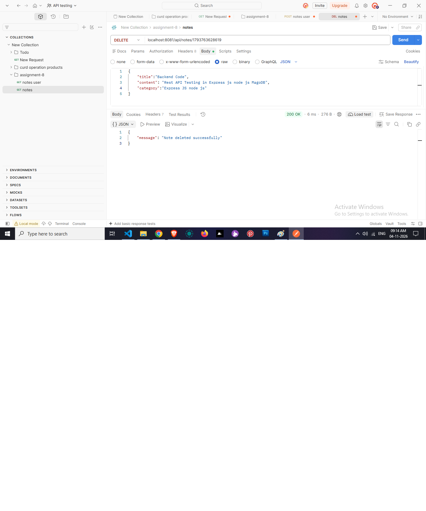

# 📝 Notes REST API – Node.js & Express

## 📌 Project Overview

This project is a RESTful Notes API developed using Node.js and Express.js.

The main objective of this assignment is to understand backend development concepts, REST API architecture, CRUD operations, user management, middleware, services, and API testing using Postman.

This project uses **In-Memory Data Storage** to manage users and notes without connecting to an external database.

## 🚀 Features

### User Management
- Create a new user.
- Manage user information.
- Handle user-related operations.

### Notes Management
- Create a new note.
- Get all notes.
- Get a single note by ID.
- Update an existing note.
- Delete a note.

### Additional Features
- RESTful API architecture.
- Modular folder structure.
- Separate controllers and services.
- Middleware for request processing.
- API testing using Postman.
- In-memory data storage.

## 🛠️ Technologies Used

| Technology | Purpose |
|---|---|
| Node.js | JavaScript runtime environment |
| Express.js | REST API development |
| JavaScript | Application logic |
| In-Memory Storage | Temporary data management |
| Postman | API testing |
| Git | Version control |
| GitHub | Source code hosting |

## 📁 Project Folder Structure

```text
notes-rest-api/
│
├── config/
│
├── models/
│   ├── userModel.js
│   └── noteModel.js
│
├── controllers/
│
├── services/
│
├── routes/
│
├── middlewares/
│
├── utils/
│
├── security/
│
├── .gitignore
├── package.json
├── package-lock.json
├── README.md
└── server.js
```

## 🏗️ Application Workflow

The application follows a modular architecture. Each folder has a separate responsibility.



## 📂 Folder Responsibilities

| Folder | Description |
|---|---|
| config | Application configuration |
| models | Stores user and note data in memory |
| controllers | Handles API requests and responses |
| services | Contains application business logic |
| routes | Defines REST API endpoints |
| middlewares | Handles request processing and validation |
| utils | Contains reusable helper functions |
| security | Handles security-related functionality |

## 👤 User Management Workflow

User management handles creating and managing user information.



### User Creation Logic

1. Receive user details from the API request.
2. Validate the incoming user information.
3. Pass the data to the service layer.
4. Store the new user in the in-memory user array.
5. Return the response to the client.

## 📝 Notes CRUD Operations

CRUD stands for:

- **Create** – Add a new note.
- **Read** – Retrieve notes.
- **Update** – Modify an existing note.
- **Delete** – Remove a note.

### Notes Workflow Diagram



### CRUD Operation Explanation

| Operation | HTTP Method | Description |
|---|---|---|
| Create | POST | Create a new note |
| Read All | GET | Retrieve all notes |
| Read One | GET | Retrieve a note using its ID |
| Update | PUT | Update an existing note |
| Delete | DELETE | Delete a note |

## 💾 Data Storage – In-Memory

This project uses in-memory data storage instead of an external database.

- User data is maintained in the user model.
- Note data is maintained in the note model.
- JavaScript arrays are used to store records.
- CRUD operations modify the stored data directly.
- No database connection is required.

**Note:** In-memory data is temporary. All stored data will be lost when the Node.js server restarts.

## 🔗 API Endpoints

The following are example REST API endpoints. Update them according to your actual route definitions.

| Method | Endpoint | Description |
|---|---|---|
| POST | `/api/users` | Create a user |
| GET | `/api/users` | Get all users |
| POST | `/api/notes` | Create a note |
| GET | `/api/notes` | Get all notes |
| GET | `/api/notes/:id` | Get a single note |
| PUT | `/api/notes/:id` | Update a note |
| DELETE | `/api/notes/:id` | Delete a note |

## 🧪 API Testing – Postman

All API endpoints are tested using Postman.

### Testing Steps

1. Start the Node.js server.
2. Open Postman.
3. Enter the API endpoint.
4. Select the appropriate HTTP method.
5. Add request body data when required.
6. Click Send.
7. Verify the JSON response and status code.

## 📸 API Testing Screenshots

Create a `screenshots` folder and add your actual Postman screenshots.

```text
screenshots/
│
├── user-create.png
├── create-note.png
├── get-all-notes.png
├── get-single-note.png
├── update-note.png
└── delete-note.png
```

### User Creation



### Create Note



### Get All Notes



### Get Single Note



### Update Note


### Delete Note



## ⚙️ Installation & Setup

### 1. Clone Repository

```bash
git clone YOUR_GITHUB_REPOSITORY_URL
```

### 2. Navigate to Project

```bash
cd notes-rest-api
```

### 3. Install Dependencies

```bash
npm install
```

### 4. Start the Server

```bash
npm start
```

For development mode, if configured:

```bash
npm run dev
```

### 5. Test API

Open Postman and use:

```text
http://localhost:8081
```

Use your actual configured port and API endpoints.

## 🎯 Learning Outcomes

Through this assignment, I learned:

- Node.js and Express.js fundamentals.
- REST API architecture.
- CRUD operations.
- User creation and management.
- Model, Controller, and Service architecture.
- Express routing and middleware.
- In-memory data handling.
- API testing using Postman.
- Backend project folder organization.

## 👨‍💻 Author

**Rajesh Kumar**

Agentic Full Stack Developer | UI/UX & Frontend Developer

Currently learning full-stack development with Node.js, Express.js, React, and modern web technologies.

---

⭐ Thank you for visiting my project!

**Assignment 9 – Notes REST API with Node.js & Express**